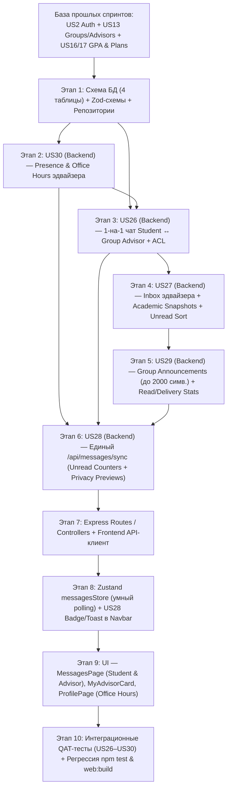

# Sprint 6 Implementation Plan — Direct Advisor Chat, Inbox, In-App Notifications, Group Announcements & Presence (US26–US30)

> **Статус документа:** Детальный технический план реализации 6-го спринта  
> **Охват фич:** US26, US27, US28 (без Email-рассылок), US29, US30 (чисто текстовый чат без фото/файловых вложений)  
> **Стоимость инфраструктуры:** **$0** (существующий Neon PostgreSQL + Vercel Hobby, 0 платных сервисов, 0 новых npm-зависимостей)

---

## 1. Архитектурные ограничения и защита ядра (Zero-Regression Rules)

Перед написанием любой строчки кода действуют жёсткие правила из `AI_rules.md` и `.gemini/rules/session-management-freeze.md`:

1. **Абсолютная неприкосновенность Session Management и Auth:**
   - **0 изменений** в `session.middleware.mjs`, `auth.middleware.mjs`, `error.middleware.mjs`, `auth.controller.mjs`, `auth.routes.mjs`, `auth.service.mjs`, `session.repository.mjs`, `cache.repository.mjs`, `src/sdu/*`, `web/src/stores/authStore.js`, `web/src/stores/scheduleStore.js`.
   - В `web/src/App.jsx` блок Auth Gate (`stage === 'boot' | 'login' | '2fa'`) **не трогается** — добавляется исключительно один маршрут `<Route path="/messages" element={<MessagesPage />} />` внутри `<Routes>`.
   - В `server/db.mjs` механика `realPool` / `pool.query` и все существующие таблицы **не изменяются** — 4 новые таблицы 6-го спринта строго дописываются в конец `initDb()` (и зеркалируются в `memTables` / `handleMemQuery` для офлайн-тестов).
   - Идентификация пользователя во всех новых контроллерах берётся только через штатный `requireAuth` (`req.client.localUsername`, `req.client.localRole`, `req.session.username`).
2. **Упрощения, согласованные по продукту:**
   - **Только текстовые сообщения** (поддержка обычного текста, многострочного ввода и стандартных Unicode-эмодзи; без загрузки фото/PDF и без хранения Base64-бинарников в БД).
   - **Только In-App уведомления** (без SMTP / Email-дайджестов).
3. **Строгие правила UI (`AI_rules.md` §7):**
   - **100% English UI** (все кнопки, вкладки, бейджи, плейсхолдеры, пустые состояния, тосты и тексты ошибок строго на английском языке).
   - Высокая контрастность палитры SDU (`#002B49`, `#0070BA`, `#00A859`, `#D9381E`).
   - Ошибки фоновых и вторичных запросов в чате/уведомлениях **никогда** не вызывают `handleAuthError`.

---

## 2. Граф зависимостей фич и логическая хронология реализации

В `UserStoryPM` фичи 6-го спринта связаны жёсткой цепочкой зависимостей (нельзя делать Inbox эдвайзера без модели диалогов, а групповые объявления — без списка групп эдвайзера и системы прочтений):



**Почему именно такой порядок:**
1. **Сначала БД и Репозитории (Этап 1):** все 5 пользовательских историй читают и пишут в общие таблицы сообщений, объявлений и присутствия.
2. **Затем US30 Backend (Этап 2) перед US26:** когда студент открывает диалог с эдвайзером (US26), шапка чата и карточка эдвайзера сразу требуют вычисленный статус (`Online` / `Away` / `Offline, was seen at HH:MM`) и `office_hours`.
3. **Затем US26 Backend (Этап 3):** ядро личных сообщений `student ↔ advisor` и проверка прав доступа (`'You can only message your own group advisor'`).
4. **Затем US27 Backend (Этап 4):** опирается на US26 (`advisor_messages`) для подсчёта непрочитанных по каждому студенту, сортировки диалогов и сброса счётчика в `0` при открытии чата, добавляя агрегацию академического мини-снэпшота (`GPA`, `ECTS`, `Last Recs`).
5. **Затем US29 Backend (Этап 5):** опирается на список назначенных групп эдвайзера из US27, фиксирует `recipient_usernames` на момент отправки и считает статистику прочтений.
6. **Затем US28 Sync Engine (Этап 6):** объединяет непрочитанные из US26 (личка) + US29 (объявления) + пинг активности US30 в один сверхлёгкий эндпоинт `/api/messages/sync`.
7. **После готовности API — Frontend Store, Navbar, страницы и QAT-тесты (Этапы 7–10).**

---

## 3. Проектирование схемы БД (Neon PostgreSQL)

В конец `initDb()` в `server/db.mjs` добавляются ровно **4 компактные таблицы** и индексы:

### 3.1. `user_presence` (US30 — онлайн-статус и приёмные часы эдвайзера)
```sql
CREATE TABLE IF NOT EXISTS user_presence (
  username VARCHAR(255) PRIMARY KEY,
  last_seen_at TIMESTAMP WITH TIME ZONE DEFAULT NOW(),
  is_online BOOLEAN NOT NULL DEFAULT TRUE,
  office_hours VARCHAR(255) DEFAULT '',
  response_time_note VARCHAR(255) DEFAULT '',
  updated_at TIMESTAMP WITH TIME ZONE DEFAULT NOW()
);
```
- **Логика вычисления статуса на лету (без фоновых воркеров):**
  - Если аккаунт в `users` удалён или `is_blocked = true`, либо `is_online = false`, либо `NOW() - last_seen_at > 5 минут` → статус **`offline`**, текст: `'Offline, was seen at HH:MM'` (если `last_seen_at` есть) или `'Offline'`.
  - Если `NOW() - last_seen_at <= 2 минут` → статус **`online`**, текст: `'Online'`.
  - Если `2 минуты < NOW() - last_seen_at <= 5 минут` → статус **`away`**, текст: `'Away'`.

### 3.2. `advisor_messages` (US26, US27, US28 — личные сообщения `student ↔ advisor`)
```sql
CREATE TABLE IF NOT EXISTS advisor_messages (
  id SERIAL PRIMARY KEY,
  student_username VARCHAR(255) NOT NULL,
  advisor_username VARCHAR(255) NOT NULL,
  group_id INTEGER REFERENCES student_groups(id) ON DELETE SET NULL,
  sender_username VARCHAR(255) NOT NULL,
  content TEXT NOT NULL,
  is_read BOOLEAN NOT NULL DEFAULT FALSE,
  read_at TIMESTAMP WITH TIME ZONE,
  created_at TIMESTAMP WITH TIME ZONE DEFAULT NOW()
);
CREATE INDEX IF NOT EXISTS idx_adv_msg_dialog ON advisor_messages(student_username, advisor_username, created_at ASC);
CREATE INDEX IF NOT EXISTS idx_adv_msg_advisor_unread ON advisor_messages(advisor_username, is_read, created_at DESC);
CREATE INDEX IF NOT EXISTS idx_adv_msg_student_unread ON advisor_messages(student_username, is_read, created_at DESC);
```
- **Почему `group_id` имеет `ON DELETE SET NULL`, а ключ диалога — `(student_username, advisor_username)`:**
  По ограничению US13/US26 удаление студента из группы или переназначение группы **не удаляет** историю его переписки с эдвайзером, но право *отправлять новые сообщения* и *открывать чат студентом* строго валидируется по текущему назначению группы.

### 3.3. `group_announcements` и `group_announcement_reads` (US29, US28 — объявления по группе)
```sql
CREATE TABLE IF NOT EXISTS group_announcements (
  id SERIAL PRIMARY KEY,
  group_id INTEGER NOT NULL REFERENCES student_groups(id) ON DELETE CASCADE,
  advisor_username VARCHAR(255) NOT NULL,
  content TEXT NOT NULL,
  recipient_usernames JSONB NOT NULL DEFAULT '[]'::jsonb,
  created_at TIMESTAMP WITH TIME ZONE DEFAULT NOW()
);
CREATE INDEX IF NOT EXISTS idx_grp_ann_group ON group_announcements(group_id, created_at DESC);

CREATE TABLE IF NOT EXISTS group_announcement_reads (
  announcement_id INTEGER NOT NULL REFERENCES group_announcements(id) ON DELETE CASCADE,
  student_username VARCHAR(255) NOT NULL,
  read_at TIMESTAMP WITH TIME ZONE DEFAULT NOW(),
  PRIMARY KEY (announcement_id, student_username)
);
```
- **Защита от утечки вышедшим из группы студентам (QAT Fail Script US29):**
  1. В момент отправки объявления в `recipient_usernames` записывается массив текущих участников группы (`group_members` на момент клика).
  2. При чтении канала студентом проверяется **одновременно**: студент **сейчас** состоит в этой группе (`group_members.group_id`) **И** его `username` входит в `recipient_usernames` (либо для новых объявлений, отправленных при нём). Если студент покинул группу — он не получает новые объявления и не числится в получателях.

---

## 4. Поэтапный план реализации по модулям

### Этап 1. Zod-схемы и Репозитории (`server/schemas/` & `server/repositories/`)
1. **Создать `server/schemas/messages.schema.mjs`:**
   - `sendDirectMessageSchema`: `{ recipientUsername?: string, content: z.string().trim().min(1, 'Message cannot be empty').max(2000, 'Message cannot exceed 2000 characters') }`.
   - `sendAnnouncementSchema`: `{ content: z.string().trim().min(1, 'Announcement cannot be empty').max(2000, 'Announcement cannot exceed 2000 characters') }`.
   - `updateAdvisorOfficeHoursSchema`: `{ office_hours: z.string().trim().max(200).optional().default(''), response_time_note: z.string().trim().max(255).optional().default('') }`.
   - `syncQuerySchema`: `{ since: z.string().optional() }`.
2. **Создать `server/repositories/presence.repository.mjs`:**
   - `touchPresence(username, isOnline = true)` — `UPSERT` в `user_presence` (`last_seen_at = NOW(), is_online = $2`).
   - `setOffline(username)` — ставит `is_online = false` (вызывается при необходимости или истечении 5 мин).
   - `getPresence(username)` — получает запись присутствия + флаг `is_blocked` из `users`.
   - `updateOfficeHours(username, { office_hours, response_time_note })` — обновляет рабочие часы эдвайзера.
3. **Создать `server/repositories/messages.repository.mjs`:**
   - Методы личных сообщений: `addDirectMessage`, `getDialogMessages(studentUsername, advisorUsername, limit)`, `markDialogRead(studentUsername, advisorUsername, readerUsername)`, `getUnreadCountsByStudentForAdvisor(advisorUsername)`, `getUnreadDirectForUser(username, role, since)`.
   - Методы объявлений: `createAnnouncement({ groupId, advisorUsername, content, recipientUsernames })`, `listGroupAnnouncementsForAdvisor(groupId)`, `listAnnouncementsForStudent(groupId, studentUsername)`, `markAnnouncementsRead(announcementIds, studentUsername)`, `getUnreadAnnouncementsForStudent(groupId, studentUsername, since)`.
   - Пакетная выборка данных для академического снэпшота студентов группы (`getStudentsAcademicRawData(usernames)`): одним запросом к `student_data_cache`, `curriculum_cache`, `student_semester_plans` и `recommendation_feedback` забирает данные по всем студентам эдвайзера без проблемы `N+1`.

---

### Этап 2. Сервис присутствия и Office Hours — US30 (`server/services/presence.service.mjs`)
1. `computePresencePayload(presenceRow, userRow)`:
   - Если `!userRow` или `userRow.is_blocked` → `{ status: 'offline', statusText: 'Offline', lastSeenAt: null, officeHours, responseTimeNote }`.
   - Вычисляет разницу `diffMs = Date.now() - new Date(last_seen_at).getTime()`:
     - `!is_online || diffMs > 5 * 60_000` → `status: 'offline'`, `statusText: 'Offline, was seen at HH:MM'`.
     - `diffMs <= 2 * 60_000` → `status: 'online'`, `statusText: 'Online'`.
     - иначе → `status: 'away'`, `statusText: 'Away'`.
2. `getAdvisorPresenceForStudent(studentUsername, targetAdvisorUsername = null)`:
   - Проверяет группу студента (`groupRepository.getStudentGroupAndAdvisor(studentUsername)`).
   - Если студент пытается запросить статус чужого эдвайзера (`targetAdvisorUsername !== membership.advisor_username`) → кидает `HttpError.forbidden('You can only message your own group advisor')` (приватность статуса US30).
3. `updateMyOfficeHours(username, role, payload)`:
   - Разрешено ролям `Advisor` (и `Administrator` для тестов/управления), сохраняет `office_hours` и `response_time_note`.

---

### Этап 3–6. Сервис сообщений, Inbox эдвайзера, Объявлений и Уведомлений — US26, US27, US28, US29 (`server/services/messages.service.mjs`)

1. **US26 — Логика личного диалога студента с эдвайзером:**
   - `getStudentConversation(studentUsername, requestedAdvisorUsername)`:
     - Загружает привязку студента к группе и эдвайзеру.
     - Если передан `requestedAdvisorUsername` и он не совпадает с назначенным эдвайзером группы студента → **`throw HttpError.forbidden('You can only message your own group advisor')`** (точное совпадение с QAT Scenario 2!).
     - Если группа или эдвайзер ещё не назначены → возвращает `{ assigned: false, group: membership?.group || null, advisor: null, messages: [] }`.
     - Помечает входящие сообщения от эдвайзера прочитанными (`markDialogRead`), подтягивает статус присутствия и `office_hours` эдвайзера (US30) и возвращает список сообщений.
   - `sendStudentMessage(studentUsername, { advisorUsername, content })`:
     - Проверяет, что у студента есть группа с назначенным эдвайзером; если `advisorUsername` передан и чужой → **`403 'You can only message your own group advisor'`**.
     - Сохраняет сообщение в `advisor_messages` и обновляет `touchPresence(studentUsername)`.

2. **US27 — Логика Inbox эдвайзера и Academic Snapshots:**
   - `getAdvisorInbox(advisorUsername, role)`:
     - Доступно только если `role === 'Advisor'` (иначе `403`).
     - Загружает **только** группы, где `student_groups.advisor_username === advisorUsername`.
     - Для всех студентов этих групп считает:
       - `unreadCount` и `lastUnreadAt` (непрочитанные сообщения от студента к этому эдвайзеру);
       - `lastMessage` (короткое превью последнего сообщения и время);
       - **Read-only Academic Snapshot**:
         - `gpa`: взвешенный по ECTS GPA по закрытым курсам из кэша транскрипта/куррикулума (по шкале `GRADE_POINTS` из `prerequisite.service.mjs`, либо `'—'` если данных ещё нет);
         - `semesterLoadEcts`: `total_ects` из `student_semester_plans` (либо сумма ECTS курсов текущей корзины `student_data_cache.approved_courses`, иначе `0`);
         - `lastRecommendationAt`: максимальная дата из `student_semester_plans.updated_at` и `recommendation_feedback.created_at` (или `null`).
     - **Сортировка по умолчанию (QAT US27 Scenario 1):**
       1. Студенты с `unreadCount > 0` идут первыми по убыванию `lastUnreadAt` (самое свежее непрочитанное сверху);
       2. Далее — по убыванию `lastMessageAt`;
       3. Далее — по имени/логину студента.
   - `getAdvisorStudentThread(advisorUsername, role, studentUsername)`:
     - Проверяет, что `studentUsername` состоит в группе этого эдвайзера (иначе `403 'Access denied: student is not in your assigned groups'`).
     - Сразу вызывает `markDialogRead`, сбрасывая `unreadCount` студента в **`0`** (QAT US27 Scenario 2), и возвращает историю диалога + read-only академический снэпшот студента.
   - `sendAdvisorMessage(advisorUsername, role, studentUsername, { content })`:
     - Проверяет принадлежность студента к группе эдвайзера (`403` для чужих групп), сохраняет сообщение и обновляет `touchPresence(advisorUsername)`.

3. **US29 — Логика групповых объявлений:**
   - `sendGroupAnnouncement(advisorUsername, role, groupId, { content })`:
     - Проверяет `role === 'Advisor'` и `group.advisor_username === advisorUsername` (`403` при попытке отправить в чужую группу).
     - Получает текущий список участников `groupRepository.listGroupMembers(groupId)`, извлекает массив `recipientUsernames`, сохраняет объявление (до 2000 символов).
   - `getGroupAnnouncementsForAdvisor(advisorUsername, role, groupId)`:
     - Проверяет владение группой, возвращает объявления со статистикой:
       `deliveredCount = recipient_usernames.length`, `readCount`, `unreadCount = deliveredCount - readCount`, `readers` (список прочитавших с временем).
   - `getStudentAnnouncements(studentUsername, markAsRead = false)`:
     - Находит текущую группу студента; если группы нет — возвращает `[]`.
     - Выбирает объявления текущей группы, где `studentUsername` входит в `recipient_usernames`.
     - Если `markAsRead === true` (студент открыл вкладку объявлений), записывает прочтение в `group_announcement_reads` → у эдвайзера мгновенно увеличивается `readCount` (QAT US29 Scenario 2).

4. **US28 — Логика In-App синхронизации и уведомлений (`syncNotifications`):**
   - `syncForUser(username, role, sinceIso)`:
     - Вызывает `presenceRepository.touchPresence(username, true)` (обновляет онлайн-статус US30).
     - Считает суммарный `unreadTotal` (`unreadDirectCount + unreadAnnouncementsCount`).
     - Если передан `sinceIso`, возвращает массив новых входящих событий `notifications` строго без полного текста:
       `{ id, kind: 'direct' | 'announcement', senderName, groupName?, preview: truncate(content, 75), createdAt }`
       *(собственные сообщения `sender_username === username` никогда не включаются — QAT Fail Script US28).*

---

### Этап 7. Маршруты Express и API-клиент (`server/routes/messages.routes.mjs`, `web/src/api.js`)

| Метод | Эндпоинт | Назначение | US |
|---|---|---|---|
| `GET` | `/api/messages/sync?since=` | Лёгкий пинг: `unreadTotal`, новые превью уведомлений, обновление `last_seen_at` | US28, US30 |
| `GET` | `/api/messages/presence/me` | Текущие `office_hours` и `response_time_note` самого эдвайзера | US30 |
| `PUT` | `/api/messages/presence/office-hours` | Сохранение `office_hours` и `response_time_note` эдвайзером | US30 |
| `GET` | `/api/messages/student/dialog?advisor=` | Открытие 1-на-1 чата студентом + статус/часы эдвайзера + `markRead` | US26, US30 |
| `POST` | `/api/messages/student/dialog` | Отправка текстового сообщения студентом своему эдвайзеру | US26 |
| `GET` | `/api/messages/student/announcements` | Список объявлений текущей группы студента | US29 |
| `POST` | `/api/messages/student/announcements/read` | Пометка объявлений группы прочитанными при открытии канала | US29 |
| `GET` | `/api/messages/advisor/inbox` | Все группы и студенты эдвайзера с `unreadCount` и Academic Snapshots | US27 |
| `GET` | `/api/messages/advisor/threads/:studentUsername` | Открытие диалога со студентом + сброс `unreadCount` в `0` | US27 |
| `POST` | `/api/messages/advisor/threads/:studentUsername` | Ответ эдвайзера студенту | US26, US27 |
| `GET` | `/api/messages/advisor/groups/:groupId/announcements` | Список объявлений группы со статистикой `deliveredCount / readCount` | US29 |
| `POST` | `/api/messages/advisor/groups/:groupId/announcements` | Отправка нового объявления всем текущим студентам группы | US29 |

---

### Этап 8. Zustand-стор `messagesStore.js` и In-App уведомления в `Navbar.jsx` (US28)

1. **`web/src/stores/messagesStore.js`:**
   - Хранит `unreadTotal`, `unreadDirect`, `unreadAnnouncements`, `initializedUser`.
   - Управляет адаптивным таймером синхронизации:
     - На странице `/messages` — обновление активного треда/списка каждые **2 секунды** (выполняет SLA `< 2 сек` без платных WebSocket-сервисов и на 100% работает на Vercel Serverless).
     - На остальных страницах — пинг `/api/messages/sync` каждые **15 секунд** только при `document.visibilityState === 'visible'` (при сворачивании вкладки запросы приостанавливаются, экономя ресурсы Neon DB).
   - При приходе новых элементов в `notifications` вызывает тост с именем отправителя и коротким превью (`New message from Dr. Smith: "Can we..."`).
   - Также слушает кастомное событие `zeme:assistant-reply` от `AiAssistantChat.jsx`: если ответ AI-ассистента пришёл при свёрнутом окне чата, показывает in-app уведомление с превью и бейдж на кнопке AI-чата (покрывает требование US28 про уведомления от эдвайзера и ассистента).
2. **`web/src/shared/ui/Navbar.jsx`:**
   - Для ролей `Student` и `Advisor` добавляется кнопка **`Messages`** с красным счётчиком `unreadTotal` (если `unreadTotal > 0`).

---

### Этап 9. Пользовательский интерфейс (`MessagesPage.jsx`, `MyAdvisorCard.jsx`, `ProfilePage.jsx`)

1. **`web/src/components/MyAdvisorCard.jsx` (US26 + US30):**
   - Отображает живой индикатор статуса эдвайзера:
     - зелёная точка **`Online`**,
     - жёлтая точка **`Away`**,
     - серый бейдж **`Offline, was seen at HH:MM`**.
   - Выводит блок **`Office Hours`** (например, `Mon, Wed 14:00-16:00`) и примечание о типичном времени ответа.
   - Добавляет кнопку **`Message Advisor →`**, ведущую сразу на `/messages`.
2. **`web/src/pages/ProfilePage.jsx` (US30 для роли `Advisor`):**
   - Если `profile?.role === 'Advisor'`, рендерит секцию **`Advisor Office Hours & Availability`** с полями `Office Hours` (плейсхолдер `e.g. Mon, Wed 14:00-16:00`) и `Typical Answer Time` (плейсхолдер `e.g. Usually replies within 2 hours on weekdays`) и кнопкой `Save Availability`.
3. **`web/src/pages/MessagesPage.jsx` — Единый адаптивный центр сообщений (`/messages`):**
   - **Режим Студента (`role === 'Student'`):**
     - Левая панель с двумя каналами:
       1. `Direct Chat · <Advisor Name>` (со статусом `Online/Away/Offline` и бейджем непрочитанных);
       2. `Group Channel · <Group Name>` (с бейджем непрочитанных объявлений).
     - Правая панель в режиме `Direct Chat`:
       - Шапка: аватар и имя эдвайзера, группа, зелёный/жёлтый/серый статус (`Online` / `Away` / `Offline, was seen at 14:05`), плашка `Office hours: ...`.
       - Лента сообщений с датой/временем и статусом прочтения (`Read` / `Sent`), поддержка многострочного текста и эмодзи, отправка по `Enter` (`Shift+Enter` — перенос строки).
       - Если студент открыл прямую ссылку `/messages?advisor=<чужой_логин>`, рендерится защитный экран с текстом `'You can only message your own group advisor'` и заблокированной отправкой (QAT US26 Scenario 2).
     - Правая панель в режиме `Group Channel`:
       - Список объявлений группы с контрастным бейджем **`Announcement`**, именем эдвайзера и временем публикации; при открытии непрочитанные объявления автоматически отмечаются прочитанными.
   - **Режим Эдвайзера (`role === 'Advisor'`):**
     - Левая панель:
       - Фильтр по назначенным группам (`All Groups` + кнопки групп эдвайзера) и строка поиска студента.
       - Переключатель режима выбранной группы: `Student Dialogs` / `Group Announcements`.
       - Список студентов всех групп эдвайзера (отсортирован по свежим непрочитанным):
         - Имя и логин студента, бейдж группы, красный счётчик `unreadCount`;
         - Компактный **Read-Only Academic Snapshot**: `GPA: 3.45` · `Load: 20 ECTS` · `Last Recs: Nov 27` + кнопка `Academic Snapshot` (открывает read-only модалку/панель с подробностями и ссылкой на профиль).
     - Правая панель в режиме `Student Dialog`:
       - При клике на студента открывает переписку, мгновенно сбрасывая `unreadCount` в `0`; вверху закреплена read-only плашка академического снэпшота студента.
     - Правая панель в режиме `Group Announcements`:
       - Форма создания объявления для выбранной группы (счётчик `0 / 2000`, кнопка `Send Announcement`).
       - История отправленных объявлений группы с бейджем **`Announcement`** и живой статистикой доставки/прочтения: **`Delivered: X · Read: Y / X`**.

---

## 5. План тестирования и критерии приёмки (QAT Verification Matrix)

Создаются **3 новых тестовых набора Vitest + Supertest** (без поломки существующих 16 файлов / 120 тестов):

1. **`test/sprint6-advisor-chat.test.mjs` (US26 & US27):**
   - Студент группы `CS-23-1` отправляет сообщение назначенному эдвайзеру A → сообщение сохраняется, у эдвайзера A `unreadCount` увеличивается на `1`.
   - Студент B из группы `CS-23-2` (эдвайзер B) пытается открыть диалог или отправить сообщение эдвайзеру A → получает `403` с точным сообщением `'You can only message your own group advisor'`, сообщение не создаётся.
   - Эдвайзер с 2 назначенными группами открывает `/api/messages/advisor/inbox` → видит студентов обеих своих групп, отсортированных по самым свежим непрочитанным сообщениям, вместе с `gpa`, `semesterLoadEcts`, `lastRecommendationAt`; студенты чужих групп отсутствуют (`403` при прямом запросе).
   - У студента 3 непрочитанных сообщения → эдвайзер открывает тред студента → сообщения помечаются прочитанными, `unreadCount` становится `0`.
   - Удаление студента из группы не удаляет ранее сохранённые записи в `advisor_messages`.
2. **`test/sprint6-announcements-notifications.test.mjs` (US28 & US29):**
   - Эдвайзер отправляет объявление `'Meeting on Friday at 14:00'` в группу `CS-23-1` → все текущие студенты группы получают его с типом/бейджем `Announcement`, а у студента увеличивается in-app счётчик непрочитанных.
   - Валидация отклоняет пустые объявления и тексты длиннее `2000` символов (`400`).
   - Студент, удалённый/вышедший из группы, **не получает** объявление.
   - Студент открывает канал группы → объявление помечается прочитанным для него, а в статистике эдвайзера `readCount` увеличивается на `1`.
   - In-app sync возвращает короткое превью (не полный длинный текст) и никогда не создаёт уведомление отправителю на его собственные сообщения.
3. **`test/sprint6-presence.test.mjs` (US30):**
   - Активный эдвайзер (`<= 2 мин`) отображается у студента своей группы со статусом `'Online'`.
   - При неактивности `> 5 мин` (или выходе) статус меняется на `'Offline, was seen at HH:MM'` вместе с расписанием `'Mon, Wed 14:00-16:00'`.
   - Заблокированный аккаунт эдвайзера никогда не отображается `'Online'`.
   - Студент чужой группы не может получить онлайн-статус не своего эдвайзера (`403`).

---

## 6. Чек-лист готовности к деплою (Definition of Done)

- [ ] Все 4 таблицы добавлены в конец `initDb()` в `server/db.mjs` + поддержаны в `handleMemQuery`.
- [ ] Защищённые файлы Session Management и Auth не затронуты (`git diff` по ним пуст).
- [ ] Реализованы бэкенд-слои (`schemas`, `repositories`, `services`, `controllers`, `routes`).
- [ ] Реализованы фронтенд-слои (`api.js`, `messagesStore.js`, `Navbar.jsx`, `MyAdvisorCard.jsx`, `ProfilePage.jsx`, `MessagesPage.jsx`, CSS-стили).
- [ ] Весь текст интерфейса проверен на 100% English-only и высокую контрастность.
- [ ] Все тесты (`npm test` — все старые + новые тесты US26–US30) и сборка (`npm run web:build`) проходят на 100%.
